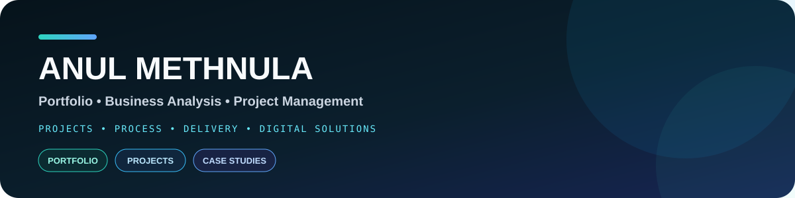
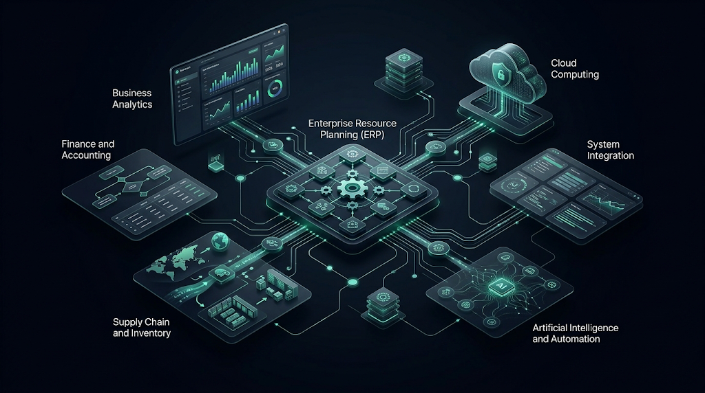
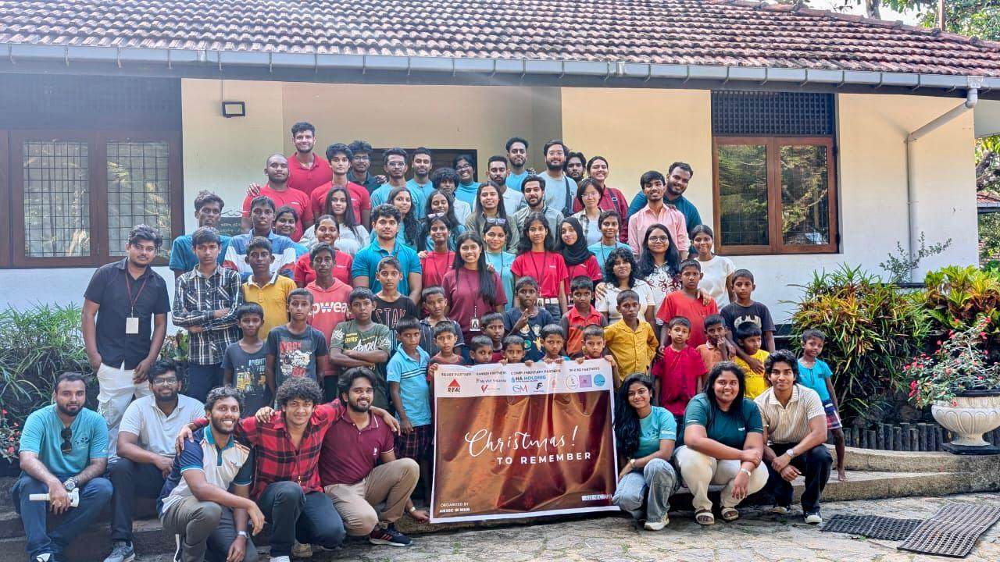

  

  
  

## Portfolio Purpose

This portfolio presents my work across **Frontend Development, Business Analysis and Project Management** in a visual format designed for recruiters, interviewers and collaborators.

## What You’ll Find

- Selected frontend, business systems and digital projects
- Requirements, process and workflow thinking
- Project coordination and planning work
- Skills, certifications and experience
- Business Analysis resume

## Preview

<table>
<tr>
<td align="center"></td>
<td align="center"></td>
<td align="center"></td>
</tr>
</table>

## Featured Work

| Area | Example | Focus |
|---|---|---|
| Frontend development | [Anything at Supun](https://github.com/anulmethnula/anythingatsupun) | Responsive storefront redevelopment |
| Business systems | CAMY / ERP projects | Requirements, workflow and operations |
| Inventory management | [StockEasy](https://github.com/anulmethnula/stock-management-system) | Purchasing, receiving and delivery workflows |
| Business Analysis | Online Gas Delivery | BPMN, process analysis and wireframes |
| Project delivery | QR E-Ticketing | Coordination, Agile and requirements |
| Leadership | AIESEC experience | Teamwork, communication and delivery |

## Core Focus

| Frontend Development | Business Analysis | Project Management |
|---|---|---|
| Responsive interfaces | Requirements gathering | Planning & coordination |
| React & TypeScript | Process analysis | Milestone tracking |
| UI components | Stakeholder needs | Team communication |
| Testing & refinement | BPMN / UML | Agile & Scrum |

## Why This Portfolio Exists

The goal is to show how I understand business problems, translate requirements into usable interfaces, and support project delivery.

## Run Locally

The portfolio is browser based. Open `index.html` locally or host it using a static hosting service.

## Resume Files

This repository currently includes my [**Business Analysis resume**](docs/resumes/Anul%20Methnula-%20BA%20Resume.pdf).

---

<b>Understand → analyse → design → develop → test → deliver.</b>

